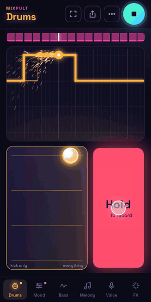

# Mixpult

Catchy night techno from your phone. A loop keeps going round and you play drums, mood, bass, melody and your own voice into it: touch a pad to hear it, hold the button to record. No notes, no chord names, nothing that can sound out of key.

**Play it: [mixpult.brezinovi.sk](https://mixpult.brezinovi.sk)** (on iPhone: Share → Add to Home Screen for full screen)

▶ [Watch the 45-second demo with sound](https://mixpult.brezinovi.sk/demo.mp4)

## What's in it

- **Six tabs.** Drums, Mood, Bass, Melody, Voice and FX. Each track is one 2D pad (up/down picks the beat, mood or pitch; left/right blends three sounds from calm to hard) and a hold-to-record button. The loop is drawn as a glowing line.
- **Your voice.** Record short clips with a count-in and chop them in from a launchpad, through a vocal chain in the Fred again.. spirit. New songs start with "work it" and "do it".
- **FX.** A filter XY pad, beat-repeat stutter, and a breakdown that drops when you let go.
- **Share.** The share button makes a link. Whoever opens it hears your track, gets a short tour, and remixes their own copy; the link always plays the original.
- **First run.** A guide to full screen, then ghost thumbs show the moves.

## Code

The app lives in [`web/`](web/): Vite, vanilla JS and Tone.js, served by a small Cloudflare Worker that also stores shared songs. See [`web/README.md`](web/README.md) for running, testing and deploying.
